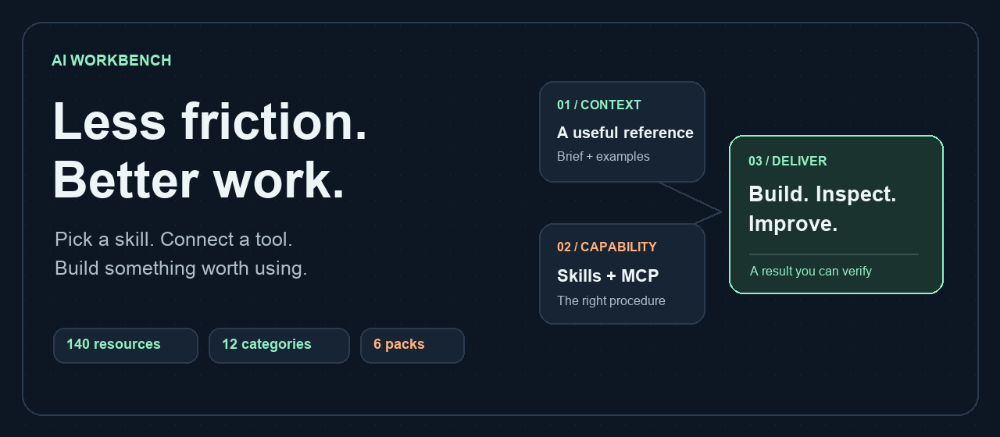
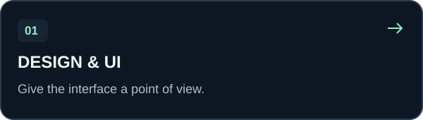
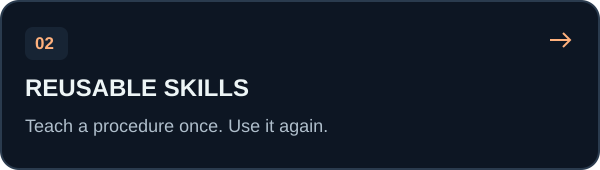
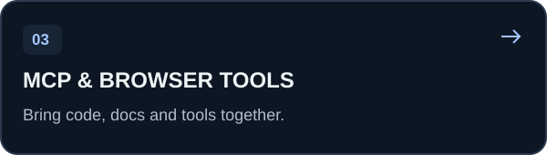
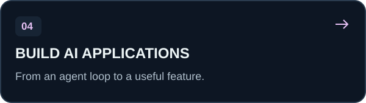
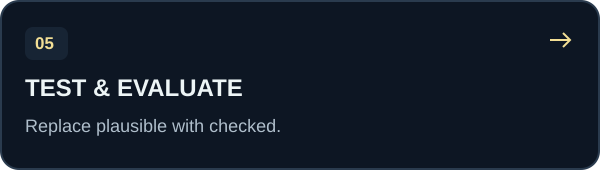
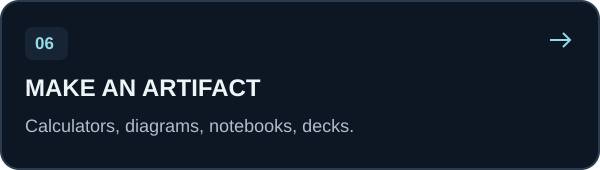
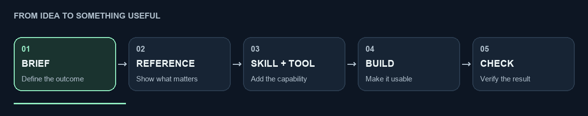

<p align="center">
  
</p>

<h1 align="center">AI Workbench</h1>

<p align="center"><strong>A developer's field guide to skills, MCP servers, prompts, references, and useful AI artifacts.</strong></p>
<p align="center">Find the right starting point. Bring better context. Build something you can actually check.</p>

<p align="center">
  <a href="CATALOG.md">Explore 140 resources</a> ·
  <a href="guides/starter-recipes.md">Try a starter recipe</a> ·
  <a href="guides/choose-your-tool.md">Help me choose</a> ·
  <a href="CONTRIBUTING.md">Contribute</a>
</p>

## Pick what you want to do

<table>
<tr>
<td width="50%"><a href="catalog/design.md"></a></td>
<td width="50%"><a href="catalog/skills.md"></a></td>
</tr>
<tr>
<td><a href="catalog/mcpdev.md"></a></td>
<td><a href="catalog/frameworks.md"></a></td>
</tr>
<tr>
<td><a href="catalog/quality.md"></a></td>
<td><a href="catalog/artifacts.md"></a></td>
</tr>
</table>

**Start small:** one clear brief + one useful reference + the capability your task needs + a check of the result. [Choose a prompt, skill, MCP, CLI, or artifact →](guides/choose-your-tool.md)

## The full directory

**140 linked resources across 12 categories**, including nine historical or superseded entries clearly separated for context. Source pages checked **2026-11-21**; tools were not installed or benchmarked for this collection. A source check is not a security audit. [How sources are recorded →](SOURCES.md)

| Category | Find this here |
| --- | --- |
| [Directories & discovery](catalog/discovery.md) | Official MCP Registry, awesome lists, skill indexes, example applications |
| [Skills & project instructions](catalog/skills.md) | Anthropic, Microsoft, Hugging Face, Vercel, standards, document and testing skills |
| [UI, design & motion](catalog/design.md) | Frontend skills, DESIGN.md, visual prompt packs, components and animation |
| [MCP · coding & browsers](catalog/mcpdev.md) | GitHub, Playwright, Chrome DevTools, Context7, SDKs and MCP Apps |
| [MCP · data & infrastructure](catalog/mcpdata.md) | Supabase, Neon, MongoDB, Redis, AWS, Azure, Cloudflare and Sentry |
| [MCP · search & work](catalog/mcpwork.md) | Search/extraction, TinyFish, Notion, Figma, Linear and Atlassian |
| [Coding agents & workbenches](catalog/coding.md) | Coding environments and software-engineering agents |
| [Build AI applications](catalog/frameworks.md) | TypeScript/Python SDKs, agent frameworks and automation |
| [Knowledge, RAG & local AI](catalog/knowledge.md) | Local model runtimes, document workflows and visual builders |
| [Testing, evaluation & observability](catalog/quality.md) | Prompt comparisons, evals, traces and browser checks |
| [Artifacts, documents & diagrams](catalog/artifacts.md) | Interactive Python tools, notebooks, diagrams, slides and animation |
| [Prompting & learning](catalog/learning.md) | Prompt libraries, cookbooks, tutorials and developer courses |

**Need more breadth?** Follow the [official MCP Registry](https://registry.modelcontextprotocol.io/), [Awesome MCP Servers](https://github.com/punkpeye/awesome-mcp-servers), [Awesome Agent Skills](https://github.com/VoltAgent/awesome-agent-skills), and [Awesome Copilot](https://github.com/github/awesome-copilot). They lead into much larger upstream collections. This repo helps you choose and apply a practical starting set.

## From idea to useful result



[View the static version](assets/workflow-static.png) · [Read the build and review workflow](workflows/build-and-review.md)

1. **Brief:** who is this for, and what should they accomplish?
2. **Reference:** show the relevant example and explain what to borrow.
3. **Capability:** use a procedure or connection that fills a real gap.
4. **Build:** deliver the actual file, feature, report, or interactive tool.
5. **Check:** exercise the user journey, inspect the render, or verify the calculation.

## Eight ways to put it to work

| Your task | Small starting combination | Try it |
| --- | --- | --- |
| Build a distinctive website | A brief + a visual specification + frontend guidance | [Recipe 1](guides/starter-recipes.md#1-build-a-distinctive-website) |
| Fix a broken frontend | Reproduction steps + browser tools + targeted debugging | [Recipe 2](guides/starter-recipes.md#2-debug-a-frontend-with-evidence) |
| Implement the right API | Actual dependency version + primary docs + project checks | [Recipe 3](guides/starter-recipes.md#3-implement-against-the-right-library-version) |
| Build a complete app journey | Synthetic data + persistence rules + acceptance criteria | [Recipe 4](guides/starter-recipes.md#4-build-a-small-app-with-a-real-data-journey) |
| Make a small interactive tool | Formula + examples + HTML, Marimo, or Streamlit | [Recipe 5](guides/starter-recipes.md#5-turn-a-calculation-into-an-interactive-artifact) |
| Finish a document or deck | Source notes + the right file procedure + rendered inspection | [Recipe 6](guides/starter-recipes.md#6-produce-a-document-or-presentation) |
| Evaluate an AI feature | Representative cases + an evaluation tool + observable results | [Recipe 7](guides/starter-recipes.md#7-add-evidence-to-an-ai-application) |
| Research and save a reusable lesson | Decision constraints + search/fetch + evidence links | [Recipe 8](guides/starter-recipes.md#8-research-and-save-reusable-lessons) |

## Copy a prompt pack

These are original recipes you can adapt without installing anything. Browsing, files, execution, skill discovery, and previews depend on the assistant and tools you actually have.

| Pack | What to send with it |
| --- | --- |
| [Websites](packs/website.md) | Product brief, annotated references, design rules |
| [Apps](packs/app.md) | User journey, sample data, acceptance criteria |
| [Artifacts](packs/artifacts.md) | Inputs, formulas, example outputs, edge cases |
| [Research](packs/research.md) | Decision, constraints, source requirements |
| [Everyday work](packs/everyday-work.md) | Audience, sanitized notes, output example |
| [Review & debugging](packs/review.md) | Current result, failure evidence, target behavior |

<details>
<summary><strong>A reusable prompt to start almost any task</strong></summary>

```text
Create [deliverable] for [audience] so they can [specific outcome].
Context: [relevant facts and permitted source files].
References: [attachments or accessible URLs]. Borrow [specific qualities].
Constraints: [stack, scope, format, available tools].
Deliver: [actual files / working artifact / report / table].
Success means: [3–5 observable criteria].

Ask about missing information only when it materially changes the result.
Otherwise state assumptions and proceed. Use the available tools to check
the output. Distinguish verified results from untested claims.
```

</details>

## Browse from your terminal

No package installation or API key is needed to search the saved directory. Python 3 is sufficient.

```bash
git clone https://github.com/vinay1668/ai-workbench.git
cd ai-workbench
python3 scripts/find.py browser
python3 scripts/find.py --category design
python3 scripts/find.py --kind Skill
python3 scripts/find.py --category mcpdata --json
```

The search excludes historical and superseded entries by default. Add `--include-history` to include them. The same directory is available as [JSON](data/resources.json) for your own tooling.

## Make your own reference pack

- [Reference pack template](templates/reference-pack.md): annotate what to borrow and why.
- [Product brief](templates/product-brief.md): define the smallest useful result.
- [Design rules](templates/design-rules.md): keep visual decisions consistent.
- [Project instructions](templates/project-instructions.md): preserve verified repository context.
- [Choosing an MCP server](guides/choosing-mcp.md): match capabilities and access to the task.
- [Evaluate a prompt or skill](workflows/evaluate.md): compare against a baseline with evidence.

## Contribute something useful

Add a resource with its original source, task, setup, limitation, review date, and verification status. Worked examples should use public or synthetic inputs and show what was actually checked. [Contribution guide →](CONTRIBUTING.md)

The directory lives in `data/resources.json`. Run `python3 scripts/build_catalog.py` after editing it, then `python3 scripts/check.py`. The original README graphics can be regenerated with `python3 scripts/make_assets.py` when Pillow is installed.

**Public material only:** no credentials, live MCP config, personal files, private URLs, customer exports, or conversation dumps. We link to upstream projects rather than copying their libraries. Original text and artwork are [MIT licensed](LICENSE); external projects retain their own terms.

“100x” is an aspiration, not a measured claim. Better context and tools should earn their place by making your actual work better.
